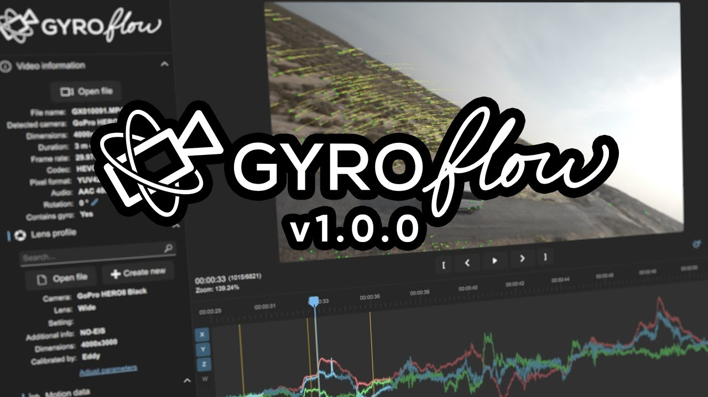
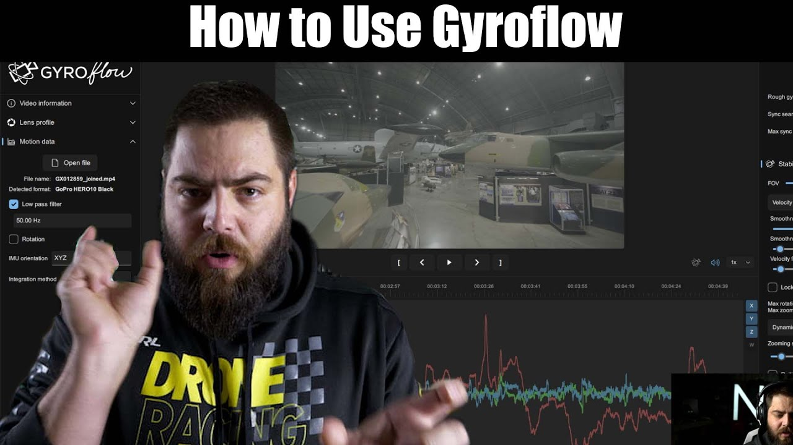

# Frequently Asked Questions

### What is Gyroflow?

[Gyroflow](https://github.com/gyroflow/gyroflow) is a free and open source third-party application that can stabilise your video by using motion data from a gyroscope and optionally an accelerometer. Modern cameras record that data internally (such as Blackmagic, GoPro, Sony, Insta360 etc), and Gyroflow stabilises the captured footage precisely by using that data. It can also use gyro data from an external source, such as Betaflight Blackbox.

**Gyroflow Toolbox** allows you to take the stabilised data from Gyroflow and use it within Final Cut Pro as an effect, so you don't have to export a ProRes from Gyroflow!

It's important to understand that **Gyroflow** and **Gyroflow Toolbox** are independent/seperate applications, that share the same render engine - [Gyroflow Core](https://docs.gyroflow.xyz/app/technical-details/gyroflow-core).

---

### Why Gyroflow Toolbox?

When I first created [BRAW Toolbox](https://brawtoolbox.fcp.cafe), one of the questions I was constantly asked was if I could support BRAW's built-in gyro stabilisation.

When researching other open source gyro stabilisation projects to use as inspiration, I came across [Gyroflow](https://gyroflow.xyz) and instantly fell in love - it's an incredible application, both from an end-users perspective, but also a developers perspective.

I ended up chatting with [AdrianEddy](https://github.com/AdrianEddy), the genius developer behind Gyroflow, and he helped me put together Gyroflow Toolbox so that Final Cut Pro users can access Gyroflow faster and easier.

---

### How can I learn more about Gyroflow?

Gyroflow has [fantastic documentation](https://docs.gyroflow.xyz/app/) that is regularly updated.

The [Gyroflow Discord](https://discord.gg/BBJ2UVAr2D) is also very active and a great way to get fast support from some of the best and nicest people in the industry.

There are also some great YouTube Videos around, such as:

---

### What Gyro Sources are supported?

You can find the full list of all the currently supported gyro sources in the [Gyroflow Documentation](https://docs.gyroflow.xyz/app/getting-started/supported-cameras).

This includes:

- GoPro (HERO 5 and later)
- Sony (a1, a7c, a7r IV, a7 IV, a7s III, a9 II, FX3, FX6, FX9, RX0 II, RX100 VII, ZV1, ZV-E10)
- Insta360 (OneR, OneRS, SMO 4k, Go, GO2, Caddx Peanut)
- DJI (Avata, O3 Air Unit)
- Blackmagic RAW (*.braw)
- RED RAW (*.r3d)
- Betaflight blackbox (*.bfl, *.bbl, *.csv)
- ArduPilot logs (*.bin, *.log)
- Gyroflow [.gcsv log](https://docs.gyroflow.xyz/logging/gcsv/)
- iOS apps: [`Sensor Logger`](https://apps.apple.com/us/app/sensor-logger/id1531582925), [`G-Field Recorder`](https://apps.apple.com/at/app/g-field-recorder/id1154585693), [`Gyro`](https://apps.apple.com/us/app/gyro-record-device-motion-data/id1161532981), [`GyroCam`](https://apps.apple.com/us/app/gyrocam-professional-camera/id1614296781)
- Android apps: [`Sensor Logger`](https://play.google.com/store/apps/details?id=com.kelvin.sensorapp&hl=de_AT&gl=US), [`Sensor Record`](https://play.google.com/store/apps/details?id=de.martingolpashin.sensor_record), [`OpenCamera Sensors`](https://github.com/MobileRoboticsSkoltech/OpenCamera-Sensors), [`MotionCam Pro`](https://play.google.com/store/apps/details?id=com.motioncam.pro)
- Runcam CSV (Runcam 5 Orange, iFlight GOCam GR, Runcam Thumb, Mobius Maxi 4K)
- Hawkeye Firefly X Lite CSV
- WitMotion (WT901SDCL binary and *.txt)
- Vuze (VuzeXR)
- KanDao (Obisidian Pro)

---

### Where can I find some Test Footage?

The Gyroflow team have kindly shared some test footage that contains gyro data on [Google Drive](https://drive.google.com/drive/folders/1sbZiLN5-sv_sGul1E_DUOluB5OMHfySh?usp=sharing).

---

### Why the Mac App Store?

As end users, we love the Mac App Store, because when we purchase a new machine, all our previously purchased apps just auto-magically appear.

We also love the fact that if you have both a Desktop and a Laptop, you can just purchase once, and use the apps on both machines without any fuss.

The Mac App store is also very secure and highly trusted. Everything that's on the App Store is reviewed on multiple levels by Apple, and goes through a detailed App Review process.

As developers, the Mac App Store does have it's negatives - Apple takes a decent cut of all the payments, and there are very strict security and sandboxing requirements.

Even Final Cut Pro itself, isn't actually sandboxed - so we had to spend a lot of time, care and attention, making sure Gyroflow Toolbox works great in a locked-down sandboxed environment.

However, we think the pro's outweight the con's - and all the extra effort to make it App Store friendly was a worthwhile endeavour.

---

### Did you have Beta Testers?

Yes, prior to public release Gyroflow Toolbox was in a public beta from 21st December 2022 to 1st January 2023, and an internal beta before that.

MASSIVE thanks to the hundreds of users who took part in this extensive beta program!

---

### Is Gyroflow Toolbox Open Source?

Yes, Gyroflow Toolbox is completely open source - you can check out it's code on [GitHub](https://github.com/latenitefilms/GyroflowToolbox).

All the code within **this repository** is licensed under [MIT](LICENSE.md).

**However**, as soon as you build/compile the Rust code, it uses [`gyroflow_core`](https://github.com/gyroflow/gyroflow/tree/master/src/core) as a dependancy, which uses the [GNU General Public License v3.0 with App Store Exception](https://github.com/gyroflow/gyroflow/blob/master/LICENSE).

This means that as soon as you build/compile Gyroflow Toolbox, the application falls under the same [GNU General Public License v3.0 with App Store Exception](https://github.com/gyroflow/gyroflow/blob/master/LICENSE) license.

Because of this, any time you build the code in this repository, the binary will also fall under the same [GNU General Public License v3.0 with App Store Exception](https://github.com/gyroflow/gyroflow/blob/master/LICENSE).