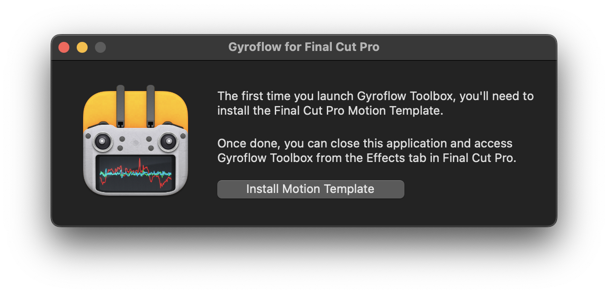
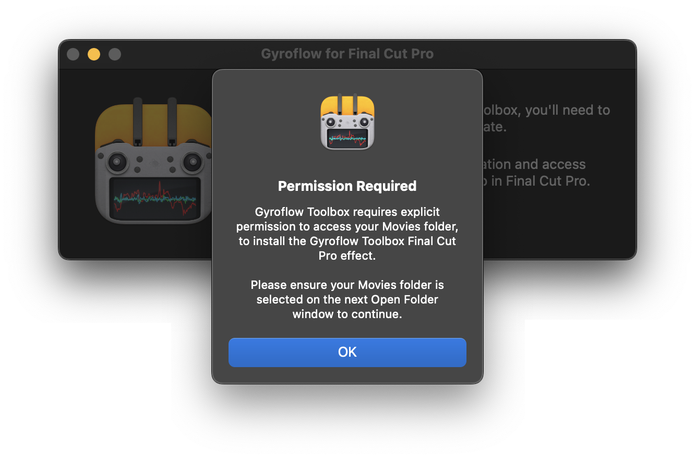
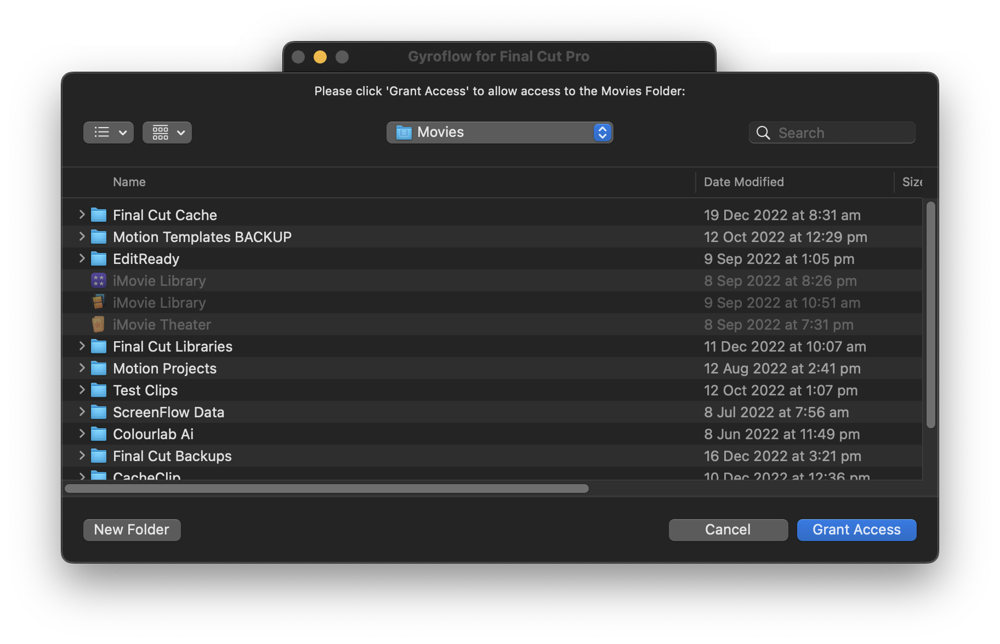
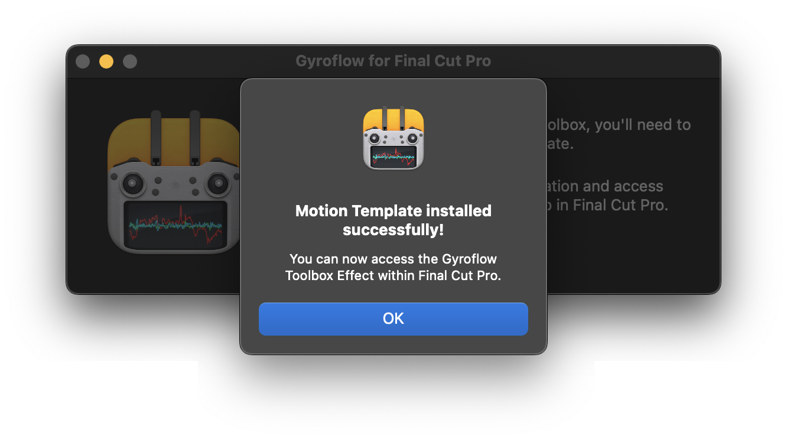
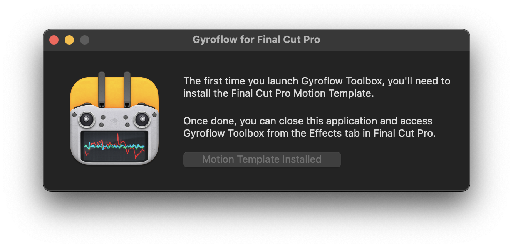

# Installation

If it's the first time installing the software, or if there's been an update to the Motion Template, you'll be prompted to **Install Motion Template**.

Once you click the button, you'll be prompted to grant permission to your **Movies** folder. This is due to macOS's sandboxing, and you'll only need to do this once. Click **OK**.

You then need to click **Grant Access**:

Once done, you'll be presented with a successful message:

The button will now be disabled, and will say **Motion Template Installed**. You can now close the Gyroflow Toolbox application.

Now that you have **Gyroflow Toolbox** installed, you can learn [how to use it](/how-to-use/).
